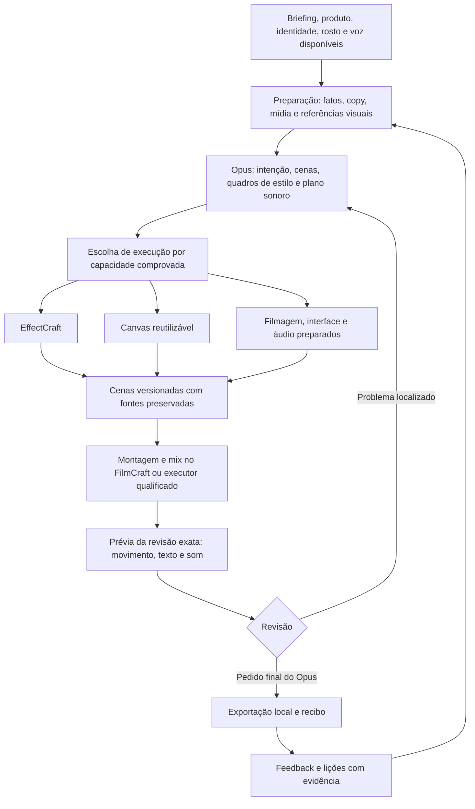

# Clicko: caminho verificável até a qualidade das referências

13/11/2026 · Plano técnico de qualidade e acompanhamento da execução. Investigação anterior: **US$ 0 de API**. Ciclo de implementação autorizado pelo usuário: provas locais antes de **uma nova ÓRBITA, com teto total de US$ 5**, incluindo direção, revisão, especialistas e correções. Não preencher consumo; não iniciar outra geração automaticamente.

## Execução do primeiro ciclo

Este documento acompanha qualidade, capacidades e evidências. O planejamento financeiro do Board of Advisors permanece no seu registro próprio. A autorização atual substitui a antiga indicação de uma tranche apenas proposta; não altera o histórico dos experimentos.

| Etapa | Estado inicial | Entrega e medição |
|---|---|---|
| 1. Baseline | Verificado | Hash do MP4 positivo conferido. Fontes arquivados, copy e feedback registrados. O arquivo é silencioso e veio de recuperação manual. |
| 2. Referências visuais | Verificado localmente | Três referências e baseline retornaram JPEGs com hashes conferidos ao diretor simulado. Ativos de análise bloqueados no caminho de produção. Som dos Reels segue sem avaliação. |
| 3. Preparação | Concluída | 15 ativos, incluindo clipes ilustrativos atribuídos, fontes OFL e quatro sons originais. Quatro quadros de estilo e prévia local de 12 s. A peça final parte de um projeto sem montagem imposta. |
| 4. Provas locais | Aprovada no escopo das fixtures | Três quadros idênticos no Craft direto, na Clicko e no Canvas. Seis defeitos detectados e zero falsos positivos em sete controles corretos. Clarão de 8 s removido na cópia ao corrigir duas sobreposições. |
| 5. Integração necessária | Concluída no Craft | O comparativo não mostrou benefício para conectar Canvas à operação exercitada. Consulta visual, inspeção de transição e teto explícito ligados ao caminho nativo. |
| 6. Conclusão local | Aprovada | 21 testes de orçamento e entrega passaram. Motor real retomou após duas interrupções. Uma sessão simulada separada recebeu referências e pediu MP4 com vídeo e áudio. US$ 0 de API. |
| 7. Uma ÓRBITA com Opus | Exportada | 18,005 s, 1080 × 1920 a 30 fps, AAC. Pedido `finish_project` registrado no lote 10. US$ 4,6347014 calculados sobre o uso informado pela Anthropic. Nenhuma cobrança incerta restante. |
| 8. Aprendizado | Evidência registrada | Resultado e decisões vinculados ao repertório como candidato. Exercício e contraexemplo preparados. Transferência ainda não executada. |

Tolerâncias das fixtures: geometria até 2 px, tempo visual até 1 quadro e evento sonoro conhecido até 50 ms. São critérios de conformidade técnica. A aprovação sonora perceptiva exige escuta identificada, e compreensão populacional exige espectadores. Sem essas avaliações, registrar pendente.

Decisão estrutural validada por revisão técnica e de produto nesta execução: referências em ferramenta separada, orçamento por tarefa persistido, exportação nativa explícita e Canvas condicional. O ciclo limitado usa direção nativa sem especialistas pagos enquanto a delegação existente não tiver um ledger financeiro compartilhado; isso fica informado ao diretor. Não usar o modo de enxame ilimitado para contornar o teto.

Artefatos locais do ciclo estão em [pasta de entrega](C:/Users/edugu/OneDrive/Documentos/res/output/clicko-quality-cycle-2026-11-13). A [prévia de ritmo](C:/Users/edugu/OneDrive/Documentos/res/output/clicko-quality-cycle-2026-11-13/orbita-animatic-local.mp4) é um estudo local de quatro quadros de estilo com cama musical. O [recibo das provas](C:/Users/edugu/OneDrive/Documentos/res/output/clicko-quality-cycle-2026-11-13/local-gate.json) vincula os resultados técnicos e o manifesto preparado por hash.

O exercício de transferência está preparado com um briefing de produto em ação e um contraexemplo de demonstração de interface. O gabarito fica fora do contexto do editor. [Exercício e critérios](../../benchmarks/studios/orbita/quality-transfer.v1.json).

Durante a sessão, o motor listou apenas fontes internas mesmo com arquivos tipográficos no projeto. A passagem para o adaptador foi corrigida e o motor real passou a localizar Unbounded no diretório de fontes preparado. O Opus havia escolhido Inter e JetBrains Mono antes da correção. A escolha de fontes deste anúncio cabe ao diretor.

### Resultado do ciclo

O Opus 5.5 consultou as quatro referências visuais, registrou a direção, salvou dez lotes de edição e solicitou a exportação. Foram 49 respostas pagas com uso registrado. Duas retomadas do mesmo job ocorreram após falhas da contagem de tokens, sem cobrança incerta. A primeira tentativa de iniciar parou na configuração da credencial local antes de criar o job. A execução, incluindo as tentativas de retomada e o render, somou cerca de 12 min 24 s de processamento medido. A composição de origem permaneceu na mesma revisão e com o mesmo hash. Nenhuma exportação manual foi usada para produzir este MP4.

| Indicador | Baseline positivo | ÓRBITA no EffectCraft |
|---|---|---|
| Sentido | Planetas entram numa película e a órbita vira assinatura. | Película com mundos, avanço para filmagem e retorno à assinatura. A categoria aparece na parte final. Compreensão de público segue pendente. |
| Direção e materialidade | Identidade gráfica própria, brilho e cor coerentes entre mundos. | A filmagem dá textura e variedade. A paleta e a tipografia têm menos personalidade nas amostras, e o crédito está pequeno a 300 px. |
| Acabamento | Clarão aos 8 s, detectado em 480 quadros. | Zero eventos do mesmo detector em 540 quadros. A janela da película invade a faixa de perfurações no fechamento, visível em 12,24 e 16,93 s. O Opus também apontou o desalinhamento no recibo. |
| Som | Faixa ausente. | AAC presente em todo o arquivo, RMS 0,0283 e pico 0,3167 na análise mono. Escuta e qualidade do mix seguem pendentes. |
| Autonomia | Exportação local recuperada após interrupção. | Exportação solicitada pelo Opus e concluída pela Clicko na revisão comprometida. |
| Custo e retrabalho | US$ 3,0205758 reportados na sessão independente. | US$ 4,6347014 pela tabela fixada no job, duas retomadas, dois scripts rejeitados e inspeções repetidas. Diferenças entre os ensaios impedem atribuição causal ao motor ou ao investimento. |

O ciclo comprovou a entrega técnica e a retirada do clarão no novo corte. O acabamento visual ainda tem um defeito concreto na assinatura e a primeira ÓRBITA conserva identidade gráfica mais distinta nas amostras. A avaliação de movimento integral, escuta, compreensão com espectadores e proximidade das referências em todas as dimensões segue aberta. O resultado permanece candidato no repertório.

A verificação final passou 38 testes de referências, orçamento, geometria e retomada. Um teste adicional confirmou que o planejamento externo não oferece ou aplica comandos de histórico reservados à interface. O teto por tarefa foi usado pela API da Clicko no ensaio. A interface do editor ainda não tem um controle para escolher esse valor. Nenhum especialista pago participou do ciclo.

[Vídeo](C:/Users/edugu/OneDrive/Documentos/res/output/clicko-quality-cycle-2026-11-13/orbita-opus-quality-cycle.mp4) · [Projeto editável](C:/Users/edugu/OneDrive/Documentos/res/output/clicko-quality-cycle-2026-11-13/orbita-opus-editavel.zip) · [Recibo de execução](C:/Users/edugu/OneDrive/Documentos/res/output/clicko-quality-cycle-2026-11-13/cycle-receipt.json) · [Medições](C:/Users/edugu/OneDrive/Documentos/res/output/clicko-quality-cycle-2026-11-13/comparison.json).

### Revisão local da ÓRBITA e continuação do aprendizado

Após a revisão, os dois novos exemplos de Claude editando foram analisados e a varredura local de cortes candidatos foi integrada às ferramentas do diretor. A prova em três materiais encontrou cortes internos na ÓRBITA e uma ação de interface que acontece sem troca de plano. O [registro dos vídeos, da prova e das próximas etapas](../studios/research/2026-11-13-claude-edicao-transferencia.md) acompanha este plano técnico.

O usuário reprovou o corte do Opus e solicitou correção da película e do crédito, recuperação da identidade da primeira ÓRBITA e revisão sonora. A revisão foi montada pelo Codex na Clicko com EffectCraft. A revisão 18 do Opus foi preservada. A nova composição é a revisão 3 de `778306e5-31c4-4475-a139-162ec4dbffcf`, exportada no job `e69ed29b-b568-4c5c-96de-6dc6c32d3d61`. Custo adicional de API de **US$ 0**.

| Indicador | Primeira ÓRBITA | Corte do Opus | Revisão local |
|---|---|---|---|
| Identidade | Planeta, órbita, céu escuro, laranja e marfim. | Película e filmagem em destaque com tipografia genérica. | Planeta com movimento próprio, fundo estelar e horizonte, laranja e marfim, Unbounded e Space Grotesk. A filmagem central permanece. |
| Película no fechamento | Motivo gráfico transformado na assinatura. | A janela invadia as perfurações durante o recuo e no fechamento. | Janela, corpo e perfurações com os mesmos tempos, centro e escala. Nos quadros 370 a 534, as duas amostras de folga entre perfurações passaram em 165 de 165 quadros. A revisão visual inclui o recuo e dois momentos da assinatura. |
| Crédito e CTA | Convite laranja, sem clipes de terceiros. | Crédito de 24 px no projeto, em uma linha. | Atribuição e licença em camadas separadas de 47 e 43 px no projeto. As duas linhas ficaram inteiras na prévia a 300 px. CTA recebeu área própria em laranja. |
| Clarão | Pico em 8 s. | Nenhum pico detectado nos 540 quadros. | Nenhum pico detectado nos 540 quadros. |
| Som | Faixa ausente. | AAC, RMS −30,96 dBFS e pico −9,99 dBFS na análise mono. | Cama musical com ganho e fade revistos, impacto aos 5,00 s e acentos nas passagens. RMS −28,67 dBFS, pico −12,74 dBFS. A janela final ficou 44,31 dB abaixo da janela pré-fade. As medidas do sinal e o posicionamento na timeline foram verificados. Escuta perceptiva e preferência sonora ficam pendentes. |
| Sentido e ritmo | Metáfora visual própria de mundos dentro da película. | Gancho, excertos e convite, com categoria só no fechamento. | Abertura e assinatura recuperam coerência de marca. O miolo ainda reúne excertos e a categoria continua no fechamento. A revisão tem o mesmo tempo de 18 s e não estabelece compreensão de público. |

A checagem do MP4 foi vinculada ao seu SHA-256 e à revisão da Clicko. A melhoria visual foi inspecionada em amostras, com medição da folga na região central da película. A qualidade artística final e a proximidade dos três alvos em todas as dimensões seguem em avaliação.

Na etapa de transferência, o SmolVLM-500M em cache recebeu dois quadros da nova ÓRBITA e a imagem de cada caso. Escolheu preservar a divisão visível no caso da interface, mas antecipou o título no caso da biblioteca, sobre a passagem da porta. Foi uma escolha entre duas operações, com **1 acerto em 2 casos**, e o caso da biblioteca reaproveitou um briefing conhecido. O exercício inédito da luminária continua pendente de gravação apropriada. A lição da película foi registrada no guia da Clicko como **candidata**, associada à revisão e ao MP4. O resultado não libera promoção automática nem nova rodada paga. O próximo teste local deve verificar a adaptação da técnica com material inédito e inspecionar a ação ao longo da sequência.

[MP4 revisado](C:/Users/edugu/OneDrive/Documentos/res/output/clicko-quality-cycle-2026-11-13/revisao-local/orbita-revisada.mp4) · [Projeto editável](C:/Users/edugu/OneDrive/Documentos/res/output/clicko-quality-cycle-2026-11-13/revisao-local/orbita-revisada-editavel.zip) · [Comparação medida](C:/Users/edugu/OneDrive/Documentos/res/output/clicko-quality-cycle-2026-11-13/revisao-local/comparacao-revisao.json) · [Revisão e aprendizado](C:/Users/edugu/OneDrive/Documentos/res/output/clicko-quality-cycle-2026-11-13/revisao-local/aprendizado-e-revisao.json).

## Remontagem local do miolo e transferência

A técnica foi identificar o que muda para o espectador, inspecionar os planos da fonte e cortar quando um novo enquadramento acrescenta informação. Uma ação que se explica pela própria continuidade pode permanecer inteira. O Codex aplicou as edições em três projetos editáveis na Clicko e solicitou as exportações ao EffectCraft local. **Gasto com API: US$ 0.**

| Caso | Decisão e evidência |
|---|---|
| **ÓRBITA · 18 s** | A intervenção se concentra de 5 a 11 s. A travessia ocupa 5–7,20 s, o detalhe da máquina 7,20–8,60 s e a escala da máquina junto à pessoa 8,60–11 s. A categoria entra no primeiro plano do miolo e dois acentos sonoros foram reposicionados. A sequência usa excertos de *Tears of Steel* (Blender Foundation, CC BY 3.0). A aproximação é construída pela montagem entre os planos. |
| **Produto · 5,03 s** | A gravação de uma fatia de torta mostra primeiro o giro e depois as camadas mais de perto. Corte confirmado a 2,73 s no MP4. O título permanece no topo. A gravação tem texto incorporado na parte inferior, visível no resultado. Prova visual sem som. |
| **Interface · 4,80 s** | A captura mostra um clipe a 0,95 s e dois a 1,25 s. O detalhe ampliado do clipe da direita está visível a 1,60 s. A extração de 4,80 s mantém a ação contínua. O detector encontrou zero candidatos a corte. Prova visual sem som. |

**Preservação e exportação da ÓRBITA.** O MP4 tem 540 quadros a 30 fps, 1080 × 1920 e áudio AAC. Na comparação quadro a quadro a 270 × 480, os 150 quadros da abertura coincidiram. Na assinatura, a diferença média foi 0,43 em 255 e a maior média por quadro foi 1,31 em 255, dentro da tolerância de 2. Fora do miolo, a diferença RMS do áudio mono foi zero na abertura e 0,00002205 na assinatura, excluindo 60 ms junto às fronteiras. O detector marcou 5,00, 7,20, 8,60 e 11,00 s e não encontrou clarões nos 540 quadros. A versão anterior tinha cinco candidatos entre 5,00 e 11,00 s além da entrada aos 5,00 s. As amostras do novo MP4 confirmam os dois cortes internos.

O exportador excedeu a memória local nas duas tentativas com os três novos clipes em 1080 × 1920. A revisão entregue usa derivados em 540 × 960 apenas no miolo, ampliados na composição final. A exportação dessa revisão levou 116,56 s. A Clicko preservou a revisão 3 de origem e o hash do seu projeto. Os três pacotes editáveis passaram no teste de integridade dos ZIPs.

[ÓRBITA MP4](C:/Users/edugu/OneDrive/Documentos/res/output/clicko-miolo-transferencia-2026-11-13/orbita/orbita.mp4) · [Projeto da ÓRBITA](C:/Users/edugu/OneDrive/Documentos/res/output/clicko-miolo-transferencia-2026-11-13/orbita/orbita-editavel.zip) · [Quadros do MP4](C:/Users/edugu/OneDrive/Documentos/res/output/clicko-miolo-transferencia-2026-11-13/orbita/quadros.jpg) · [Recibo da ÓRBITA](C:/Users/edugu/OneDrive/Documentos/res/output/clicko-miolo-transferencia-2026-11-13/orbita/recibo.json) · [Medições das três exportações](C:/Users/edugu/OneDrive/Documentos/res/output/clicko-miolo-transferencia-2026-11-13/validacao.json).

A transferência foi exercitada com material real e execução orientada pelo Codex. A escolha autônoma pelo Opus, a compreensão com espectadores e a aprovação perceptiva do som da ÓRBITA seguem sem medição nesta rodada. O caso de produto usa uma gravação de torta disponível localmente. O exercício específico da luminária continua pendente de material.

[Produto MP4](C:/Users/edugu/OneDrive/Documentos/res/output/clicko-miolo-transferencia-2026-11-13/produto/produto.mp4) · [Projeto de produto](C:/Users/edugu/OneDrive/Documentos/res/output/clicko-miolo-transferencia-2026-11-13/produto/produto-editavel.zip) · [Interface MP4](C:/Users/edugu/OneDrive/Documentos/res/output/clicko-miolo-transferencia-2026-11-13/interface/interface.mp4) · [Projeto de interface](C:/Users/edugu/OneDrive/Documentos/res/output/clicko-miolo-transferencia-2026-11-13/interface/interface-editavel.zip) · [Medições dos dois testes](C:/Users/edugu/OneDrive/Documentos/res/output/clicko-miolo-transferencia-2026-11-13/validacao-produto-interface.json).

## Edição e revisão sem prazo total

Na direção de vídeo com Claude Messages, a opção **Edição e revisão sem prazo total**, ativada inicialmente na interface, deixa o Claude decidir quantas iterações a montagem precisa. Os rascunhos são salvos após lotes válidos. A Clicko mantém os limites financeiros e o tempo máximo por operação. Uma sessão interrompida pode ser retomada com o mesmo pedido, a mesma revisão de origem e o orçamento restante. A idade total de uma sessão ativa não dispara retomada.

No próximo ensaio da ÓRBITA, partir do projeto do miolo remontado e preservar 0–5 s e 11–18 s. Dar ao Claude os três exemplos visuais e os trechos disponíveis. Pedir um primeiro corte completo, uma revisão em escala de celular e uma alternativa onde houver uma passagem com problema observável. Comparar o trecho antes e depois em movimento. Conferir a função de cada cena, a legibilidade, a identidade, o sincronismo e a ausência de clarões. A qualidade perceptiva do som exige escuta. Vincular a revisão ao MP4 e registrar tempo total, gasto e intervenções. A duração livre é da sessão de edição. A faixa de 5–11 s vem do escopo desta remontagem.

A validação local desse modo passou com o EffectCraft real e respostas simuladas. Em sete turnos, o relógio da sessão avançou artificialmente 25.200 s. O fluxo consultou as referências, salvou dois lotes, fez prévia e revisão temporal, recebeu o pedido de exportação e produziu MP4 com imagem e som. Repetir o pedido devolveu o mesmo recibo. Outro caso retomou o rascunho após duas interrupções e exportou. A suíte anterior de 34 casos, o teste atualizado da iteração longa, a nova variação de retomada, os quatro testes de encaminhamento/conexão e a verificação TypeScript passaram. **API neste trabalho — US$ 0.**

O encaminhamento da Clicko mantém a conexão do modo sem prazo total até a resposta ou o fechamento pelo cliente. Cada chamada ao modelo e cada operação local têm tempo técnico próprio para detectar travamentos. O modo mantém o orçamento e o salvamento por revisão. A simulação verificou continuidade e integridade da execução. A qualidade editorial do Claude com esse modo ainda exige um ensaio real, comparação com as referências e avaliação do vídeo.

[Registro da validação](C:/Users/edugu/OneDrive/Documentos/res/output/clicko-open-ended-2026-11-13/validacao.json) · [Prova de retomada](C:/Users/edugu/OneDrive/Documentos/res/output/clicko-open-ended-2026-11-13/retomada.xml).

## Ensaio real do Opus com tempo livre

O usuário pediu uma demonstração em edição real após a validação local. Este é um novo ensaio explícito, com teto de US$ 5 para a tarefa inteira. O gasto do primeiro ciclo permanece registrado acima. O novo ensaio usa Opus 5.5 direto na Anthropic, em modo sem prazo total, a partir de uma cópia do projeto do miolo local. Abertura de 0–5 s e assinatura de 11–18 s fazem parte do escopo de preservação. O diretor decide as alterações de 5–11 s e solicita a exportação.

A revisão usa duas lentes conceituais do conselho, sem novos agentes pagos. A lente de clareza da descoberta pergunta o que o espectador passa a entender a cada mudança de escala. A lente de precisão da montagem pergunta se a atenção chega ao sujeito relevante após cada corte. São traduções operacionais inferidas dos perfis documentados de Spielberg e Fincher. O teste observável será comparar os quadros vizinhos às passagens, o encadeamento do miolo e a leitura da categoria a 300 px. A interpretação espontânea por espectadores e a escuta perceptiva seguem pendentes. A hipótese deste ensaio é que liberdade para iterar com referências acessíveis produz uma sequência mais intencional. O ensaio isolado reúne mudanças de contexto e de direção, o que limita a atribuição causal ao tempo livre.

O preço fixado para a contabilidade é US$ 4 por milhão de tokens de entrada, US$ 20 de saída, US$ 5 de escrita de cache de cinco minutos e US$ 0,20 de leitura de cache. O custo será calculado sobre os campos de uso de cada resposta, com cobranças incertas registradas à parte. [Tabela oficial consultada](https://platform.claude.com/docs/en/models/opus-5-5/whats-new-opus-5-5).

Projeto de origem `b6970aab-20ba-48aa-9c21-1b0fc2607a09`, revisão 3, SHA-256 nativo `e243f2aa209ab89fc498277a361664cfac65248dc8978c0393d9c53ad623ddc5`. Projeto do ensaio `acee0fdc-007b-47be-8eae-70a5f5eb2381`. A pré-verificação conferiu a credencial armazenada, a conexão, a tabela de preços, a revisão da origem e as quatro evidências visuais. Nenhuma API paga foi usada na preparação. A sessão de edição já foi submetida, com registro em [recibo do ensaio](C:/Users/edugu/OneDrive/Documentos/res/output/clicko-orbita-opus-real-2026-11-13/recibo.json).

### Correção observada durante a sessão real

A primeira parte do job fez 19 respostas pagas e registrou US$ 2,2500598 antes de aplicar um lote. Os recibos mostram consultas repetidas às mesmas camadas e referências. A inspeção da compactação revelou que as propriedades consultadas e as imagens das referências eram descartadas. O contexto renovado conservava os IDs, a visão resumida e as imagens de fontes. A falha de preservação é reproduzível no código. Sua participação na repetição editorial é uma hipótese apoiada pela sequência de ferramentas, a conferir na retomada.

O Codex interrompeu a conexão ao final de uma resposta, preservou a contabilidade sem exposição incerta e guardou um checkpoint da composição inicial, com lote zero. A conexão foi reativada e o mesmo job foi retomado com o orçamento restante. Essa intervenção é parte do resultado de autonomia. O checkpoint inicial contém a edição local de origem.

A correção preserva a inspeção detalhada da revisão corrente, o contrato de ferramenta consultado mais recentemente e os pixels de referência nas renovações sucessivas. Inspeções de revisões anteriores recebem descarte quando há uma edição. Vinte e quatro testes de histórico, contabilidade e inspeção passaram. A verificação adicional da preservação dos contratos também passou antes da retomada. O gasto das 19 respostas permanece integralmente no total deste ensaio. [Intervenção registrada](C:/Users/edugu/OneDrive/Documentos/res/output/clicko-orbita-opus-real-2026-11-13/intervencao-contexto.json) · [Testes locais](C:/Users/edugu/OneDrive/Documentos/res/output/clicko-orbita-opus-real-2026-11-13/contexto-testes.xml).

### Resultado da edição real

O Opus aplicou quatro lotes de script no EffectCraft e chamou `finish_project`. A Clicko exportou a revisão 3 do projeto do ensaio, com 18,005 s, 1080 × 1920 a 30 fps e áudio AAC. SHA-256 do MP4 `969284477d6de1f29baac2d9762ea2847bffe6bb2028c1976c8e306437abab10`. O ZIP editável passou na checagem de integridade.

**Custo total de US$ 4,4462716**, calculado sobre o uso informado em 33 respostas do Opus 5.5. Cobrança incerta de US$ 0. Desse total, US$ 2,2500598 ocorreram antes da correção do contexto e US$ 2,1962118 depois. A tarefa ficou US$ 0,5537284 abaixo do teto. O saldo exato da conta Anthropic permanece sujeito à conferência no Console. Este recibo mede o ensaio. O primeiro ciclo de US$ 4,6347014 continua separado. A soma desses dois ensaios deste roteiro é US$ 9,080973, sem representar todo o histórico da conta.

Tempo ativo registrado pelo executor de 647,984 s, cerca de 10 min 48 s. Da primeira submissão à exportação decorreram 957,930 s, cerca de 15 min 58 s, incluindo a pausa para reparar e testar o histórico. O ensaio terminou dentro dessa janela e não demonstra a necessidade de uma sessão de várias horas.

| Dimensão | Comparação observada |
|---|---|
| Texto | A categoria passou de 42 px no projeto para duas camadas de 62 px, com base escura maior e permanência de cerca de 5,17 a 11 s. A leitura a 300 px melhorou nas amostras. |
| Movimento | O detalhe aproxima de 200% a 214% entre 7,20 e 8,60 s. O encontro recua de 240% a 200% até 10,10 s, ancorando a borda direita. A montagem continua com três planos e os mesmos cortes. As amostras de 0,20 s mostram a mudança de enquadramento. |
| Função e sentido | A categoria liga os planos à mostra durante todo o miolo. A relação de escala com a pessoa permanece parcial, pois ela continua junto à borda esquerda do material. A inferência de encontro precisa de cobertura mais clara. |
| Preservação | Nos 150 quadros iniciais reduzidos a 180 × 320, diferença média zero. Nos 210 quadros da assinatura, diferença média 0,29351 e pior média por quadro 1,20819 em 255, dentro da tolerância de 2. O áudio mono a 48 kHz coincidiu nas duas janelas externas ao miolo. |
| Clarão | Zero eventos do detector em 540 quadros. |
| Som | Stream AAC presente e áudio externo ao miolo preservado. O Opus manteve a montagem sonora existente. Escuta e aprovação perceptiva ficam pendentes. |
| Autonomia | Pedido final de exportação registrado pelo Opus e concluído. Houve intervenção do Codex para reparar o histórico, guardar o checkpoint inicial e retomar o mesmo job. A prova de autonomia completa permanece aberta. |
| Revisão | O diretor usou prévias amostradas e corrigiu a composição em quatro lotes. Não chamou `review_clip`, apesar de a ferramenta estar disponível. A revisão independente amostrou o miolo a cada 0,20 s e verificou o MP4 após exportação. |
| Meta das referências | O ganho constatado foi legibilidade e enquadramento. A transformação editorial e o acabamento complexo das referências continuam sem demonstração neste corte. A peça permanece candidata, com revisão necessária. |

A falha de contexto foi corrigida e a retomada passou a produzir edições. O ensaio reúne uma intervenção no histórico, uma retomada e decisões editoriais, o que impede atribuir todo o ganho ao tempo livre. O próximo problema concreto é preparar um enquadramento em que sujeito e máquina estejam suficientemente visíveis e conferir a revelação em quadros consecutivos. A presença de movimento geométrico não comprova que o espectador percebeu a relação pretendida.

[Vídeo real do Opus](C:/Users/edugu/OneDrive/Documentos/res/output/clicko-orbita-opus-real-2026-11-13/orbita-opus-real.mp4) · [Projeto editável](C:/Users/edugu/OneDrive/Documentos/res/output/clicko-orbita-opus-real-2026-11-13/orbita-opus-editavel.zip) · [Recibo](C:/Users/edugu/OneDrive/Documentos/res/output/clicko-orbita-opus-real-2026-11-13/recibo.json) · [Medições](C:/Users/edugu/OneDrive/Documentos/res/output/clicko-orbita-opus-real-2026-11-13/comparacao.json) · [Avaliação editorial](C:/Users/edugu/OneDrive/Documentos/res/output/clicko-orbita-opus-real-2026-11-13/avaliacao-editorial.json) · [Miolo quadro a quadro amostrado](C:/Users/edugu/OneDrive/Documentos/res/output/clicko-orbita-opus-real-2026-11-13/opus-miolo.jpg).

## Diagnóstico do movimento e da qualidade do EffectCraft

O usuário reprovou o vídeo real e perguntou se o EffectCraft explica o resultado. A investigação seguinte usou **US$ 0 de API**. Ela examinou o fonte nativo exportado, os scripts do Opus, a preparação da filmagem, o adaptador de render e um controle novo de movimento no mesmo build instalado.

| Causa examinada | Evidência nova | Alcance |
|---|---|---|
| Curva escolhida no anúncio | Os keyframes de posição e escala do encontro são `Linear`, com `in_ease` e `out_ease` vazios. O Opus criou dois pontos para o recuo e deixou a saída parar ao alcançar o segundo. `motion_blur=false`, `frame_blend=Off` e amostragem `Bilinear` nas duas camadas inspecionadas. | A curva e os switches usados são observáveis no projeto. A ausência de easing no corte veio da animação solicitada e salva. |
| Easing no motor instalado | Controle de 480 × 320, 30 fps e 60 quadros, com dois quadrados percorrendo o mesmo caminho, um linear e outro Bézier com velocidades nulas nas pontas. O maior erro entre trajetória renderizada e esperada foi **0,44445 px**, dentro dos 2 px definidos. | Comprova a execução dessa curva neste build. Motion blur, 3D e acabamento de anúncios complexos exigem qualificação própria. |
| Integração de movimento | Os 60 quadros RGB decodificados do controle renderizado direto no EffectCraft coincidiram integralmente com os renderizados pela Clicko. | A ligação Clicko–EffectCraft preservou o resultado deste controle. Outros recursos não foram abrangidos. |
| Cadência da filmagem | Reprodução exata da preparação antes do H.264 intermediário. Travessia com 66 quadros e 52 imagens únicas. Detalhe com 42 e 29. Encontro com **72 e 36**. No encontro, 1,49 s de material a 24 fps foi esticado para 2,40 s, equivalente a cerca de **14,9 imagens de ação por segundo**. | A repetição já existe na mídia entregue ao editor. O arquivo de 30 fps mantém essa cadência de ação reduzida. |
| Resolução e enquadramento | O master local tem 1280 × 534. A preparação da máquina recorta uma região de **300 × 534**, amplia para 540 × 960 e o projeto a amplia para 1080 × 1920. No zoom de 240%, a ampliação linear chega a **4,32 vezes** o recorte inicial. | A definição e parte da pessoa foram perdidas na preparação. Reenquadrar o derivado amplia o conteúdo restante. |
| Controles da exportação | O serviço envia `quality=high`. O adaptador usa os defaults do `OutputModule` e não lê esse parâmetro. H.264 recebe bitrate padrão de 10.000 kb/s. O job usa `accel=None`. | Há controles e aceleração sem ligação nessa rota. A contribuição visual do bitrate e a paridade com outro executor continuam por medir. A rota CPU e a memória disponível afetam custo de render e capacidade operacional. |

O primeiro controle pediu keyframes em 0,25 e 1,75 s. O motor os guardou em 7/30 e 52/30 s. A comparação apenas por posição falhou com 6,66 px, enquanto a diferença de tempo ficou em meio quadro. O controle seguinte usou tempos exatos de quadro, 0 e 1,5 s, e passou. Ambos os controles foram preservados. Esse detalhe deve ser considerado ao conferir comandos que pedem tempos entre quadros. No recuo da ÓRBITA, 8,60 e 10,10 s já caem em quadros exatos a 30 fps.

O repositório oficial documenta curvas Bézier/Easy Ease e motion blur. Sua documentação apoia o mapa de capacidades, enquanto o controle local comprova apenas as operações exercitadas neste build. [Animação do EffectCraft](https://github.com/storytold/effectcraft) · [Ferramenta de curvas e API de easing](https://github.com/storytold/effectcraft/blob/main/docs/plugins.md).

A preparação que fizemos impôs perdas concretas antes do editor. A prioridade da correção é disponibilizar a fonte com enquadramento suficiente, manter sua cadência temporal quando o briefing pedir movimento natural e usar a fonte de produção na exportação. A preparação deve registrar o recorte e a mudança de velocidade para o diretor. Depois, qualificar curvas, desaceleração e o fim do movimento no trecho real. O seletor de qualidade precisa ser ligado a parâmetros explícitos e medidos. Operações avançadas que falharem em prova equivalente entram em comparação com outro executor por cena.

A evidência atual sustenta três conclusões operacionais. A Clicko consegue transmitir a curva testada ao EffectCraft com os mesmos pixels. O anúncio foi feito com uma curva linear e material de baixa definição e cadência reduzida. O teto de acabamento do EffectCraft em composição complexa permanece em aberto. Uma nova cobrança de API acrescentaria incerteza enquanto esses insumos e critérios continuassem iguais.

[Controle de movimento em MP4](C:/Users/edugu/OneDrive/Documentos/res/output/clicko-effectcraft-diagnostico-2026-11-13/clicko.mp4) · [Quadros comparativos](C:/Users/edugu/OneDrive/Documentos/res/output/clicko-effectcraft-diagnostico-2026-11-13/comparacao-easing.jpg) · [Medições e fonte auditado](C:/Users/edugu/OneDrive/Documentos/res/output/clicko-effectcraft-diagnostico-2026-11-13/diagnostico.json) · [Projeto editável do controle](C:/Users/edugu/OneDrive/Documentos/res/output/clicko-effectcraft-diagnostico-2026-11-13/controle-editavel.zip).

## Decisão

**O fluxo híbrido é um caminho plausível para a meta, mas não basta por si só.** A recomendação é preparar materiais e direção, corrigir a observação do resultado e qualificar os executores por operação. Reaproveitar Canvas/Chromium faz parte desse trabalho. Não existe ainda prova de que integrar outro motor, aumentar agentes ou gastar mais fará a Clicko alcançar as três referências.

Há capacidades úteis já construídas: edição por código, rascunhos, retomada, inspeção, memória externa e exportação local. Existe inclusive uma ponte EffectCraft → FilmCraft. O trabalho é completar e comprovar esse fluxo, preservando a liberdade editorial do Opus e o primeiro avanço reconhecido pelo usuário.

O objetivo comercial continua sendo receber materiais de produto/serviço e apresentador e entregar um anúncio. A prioridade desta fase é qualidade audiovisual; a demonstração de um piloto não substitui essa meta. Dominar qualquer tipo de vídeo é uma direção de produto de longo prazo, não uma capacidade demonstrada pelas três referências.

## O que a investigação estabeleceu

| Achado | Evidência e limite | Consequência para a decisão |
|---|---|---|
| As fichas novas chegam como descrição, sem carregar automaticamente seus exemplos visuais. | `craft_direction.references` devolve JSON; `evidenceImage` guarda filenames; `view_image_asset` exige ativo registrado. Os hashes das três folhas atuais não aparecem no cadastro consultado. Isso não exclui outras imagens importadas anteriormente. | Ligar referência, trecho, imagem e ativo acessível ao diretor. Uma ficha no contexto não comprova que ele viu o exemplo. |
| A sessão do diretor ainda não executa o Canvas independente. | O rascunho usa um engine por sessão; o renderizador positivo é externo e específico da ÓRBITA. | Criar um adaptador reutilizável apenas depois de qualificar seu contrato de saída. Evitar reconstruir infraestrutura em cada vídeo. |
| A montagem híbrida pode aproveitar uma ponte existente. | `craft.py:1610–1663` exporta composição do EffectCraft, registra dependências e aplica `composition.link` no FilmCraft. Hoje essa rota exige origem EffectCraft. | Estender a interoperabilidade necessária; não reconstruir toda a montagem, mídia e exportação. |
| Preparação de mídia/copy e ferramentas da sessão não fecham o percurso do cliente. | Kit e dossiê existem; há itens ainda não importados. A busca pública desta sessão traz imagens. Voz, vídeo e geração têm mecanismos em outros módulos, sem uma passagem completa pelo diretor. | Coordenar as capacidades existentes e registrar necessidades não atendidas. Não confundir encontrar uma imagem com preparar uma ação de produto. |
| A revisão não comprova escuta nem movimento integral. | `review_clip` envia ao modelo imagens, medidas e metadados; um arquivo reproduzível na interface não significa que o modelo ouviu o mix. Amostragem e janelas locais existem, com cobertura limitada. | Examinar passagens em sequência e criar revisão sonora real; distinguir medição técnica, escuta e julgamento editorial. |
| O positivo independente ainda é incompleto. | MP4 de 16 s, feedback positivo do proprietário, sem áudio; exportação recuperada manualmente depois do encerramento da sessão. O clarão está no próprio código Canvas. | Preservar esse baseline. Não chamá-lo de anúncio aprovado ou prova de superioridade causal do Canvas. |
| A memória existe, mas o aprendizado geral continua por provar. | Fichas, feedback e lições versionadas existem. As três novas técnicas estão como `knowledge_only`/`not_tested`. | Demonstrar escolha, execução, contraexemplo e transferência para outro briefing antes de promover uma técnica. |

Fontes de código, linhas e escopo: [auditoria técnica](../studios/research/2026-11-13-motion-quality-investigation/10-backend-audit.md). Hipóteses concorrentes e comparação visual: [análise editorial](../studios/research/2026-11-13-motion-quality-investigation/12-causal-editorial-analysis.md).

**Prova local nova:** oito solicitações de quadro do renderizador existente, em seis tempos distintos, com repetições fora de ordem e comparação adicional em página nova. Os quadros repetidos coincidiram por hash; todas as amostras eram opacas (alfa 255). Foram 4,26 s para essas solicitações, não para um filme completo. O salto de brilho perto de 8 s permaneceu. O pacote de fontes/fontes tipográficas foi arquivado e reproduzido de uma extração separada no mesmo ambiente, com os mesmos hashes dos quadros. Isso sustenta reutilização pontual, mas não prova transparência, suavidade integral ou qualidade artística. [Recibo e reprodução](../studios/research/2026-11-13-motion-quality-investigation/probes/README.md).

Os ensaios anteriores mudaram ferramentas, contexto e materiais simultaneamente. Por isso, não isolam quanto da diferença veio do editor, da direção ou da mídia.

## Meta editorial preservada

| Referência aceita | O que buscamos aprender e aplicar | O que não foi comprovado |
|---|---|---|
| [@paulo.ia — Olise/bola dourada](https://www.instagram.com/reel/Dd5Md7NMj7P/) | Motivo reconhecível entre planos; escala, profundidade, textura e continuidade visual. | Ferramentas originais, qualidade sonora e trajetória fina de todos os movimentos. |
| [@creators / @martsromero — matcha](https://www.instagram.com/reel/DdW0UoSxXsX/) | Produto participando de gestos e contextos reais; variedade de planos a serviço de uma ação. | Uma receita universal de transições ou uma jornada contínua de uma única pessoa. |
| [@moonsol.design — colagem](https://www.instagram.com/moonsol.design/reel/Dcys2J3MfYK/) | Preparação por componentes, correspondência entre silhueta e objeto, hierarquia de retrato e texto. | Que a duração do tutorial seja a cadência ideal de um anúncio ou que sua instrução de 0,5 s valha para qualquer peça. |

São alvos de dimensões diferentes. Não basta copiar a densidade de cortes. O plano precisa tornar perceptíveis a mensagem, a transformação e a identidade do produto. O processo da Ordinary Folk reforça a utilidade de mensagem, design/storyboard e áudio pensado desde o início; é um relato de prática, não uma garantia científica de resultado. [Processo do estúdio](https://www.ordinaryfolk.co/process).

O processo atribuído ao Matheus fica como registro histórico: materiais organizados, ferramentas prontas, referências persistentes, planejamento, prévia, correção e entrega. Sua página não pôde ser reaberta nesta rodada. Não afirmamos ter observado seu pipeline interno nem que sua ferramenta seja obrigatória. [Auditoria de procedência](../studios/research/2026-11-13-motion-quality-investigation/13-reference-and-provenance.md).

## Arquitetura proposta

Esse é um desenho proposto, não uma integração já entregue. Uma peça pode usar um único executor quando isso for suficiente. O Opus escolhe duração, linguagem, cenas, cortes, camadas e efeitos; o contrato mantém materiais e resultados consistentes. Não impõe template, número de cenas ou frequência de cortes.

**Contrato de referência:** URL/autoria, cobertura observada, tempos, imagens ou trechos registrados, assetId/hash, áudio avaliado ou pendente, função editorial, contraexemplo e teste reproduzível. Material de análise e material autorizado/preparado para produção têm papéis separados.

**Contrato de cena:** sceneId, intenção e estados, fonte editável, revisão, executor/build, ativos/fontes e hashes, dimensões, FPS racional, duração em quadros, cor/alfa, clipe de saída, stems/eventos sonoros e evidência de revisão. Fonte nativa e código livre continuam possíveis. O clipe renderizado não substitui o projeto-fonte.

**Contrato de entrega:** projeto e revisão fixados; rascunhos retomáveis; pedido `finish_project` rastreável; exportação/mix locais independentes da conexão do modelo; MP4 final ligado ao recibo. Recuperação humana fica identificada.

Preservar isolamento de credenciais, integridade de arquivos, revisão correta e controle de gasto. Essas proteções não limitam a estética. Separar orçamento de inferência, tempo de trabalho, duração do anúncio e delegação, hoje parcialmente acoplados.

## Etapas práticas e condições para avançar

| Etapa / responsável funcional | Trabalho concreto | Prova para concluir |
|---|---|---|
| **P0.1 — Pesquisa e direção editorial** | Preservar baseline por hash; registrar as evidências visuais das três referências como ativos consultáveis. Completar a observação dos trechos e do som necessários à comparação. Definir rubrica por dimensão e fatos/copy da ÓRBITA. | Uma referência selecionada chega ao contexto como pixels identificados e ordenados, não apenas filename. Critérios e cobertura ficam registrados antes da comparação. Uma dimensão sem cobertura temporal/sonora suficiente fica explicitamente não comparável. |
| **P0.2 — Engenharia de execução** | Qualificar cenas necessárias: texto/curvas; recorte/oclusão; luz/sombra quando requeridas; passagem e sincronismo. Rodar a mesma cena no Craft direto e pela Clicko; depois comparar a operação equivalente em Canvas. | Localização reproduzível de falha do motor ou integração, ou aprovação da operação nas condições medidas. Materiais, fontes, especificação visual e condições iguais; tolerâncias definidas antes do teste. |
| **P0.3 — Revisão audiovisual** | Calibrar detecção com pares corretos/defeituosos: colisão real, pico luminoso, texto ilegível, som ausente ou deslocado. Revisar movimento por janelas e o mix efetivamente ouvido. | Acertos e falsos positivos registrados por tipo e tempo, inclusive controles corretos. Sem aprovação sonora baseada só em RMS/transcrição e sem aprovação temporal baseada só em stills. |
| **P1.1 — Engenharia de integração, condicional a P0.2** | Se a prova justificar Canvas, tornar o runtime reutilizável e conectar cenas completas opacas à montagem com fontes/revisões preservadas, aproveitando cadastro, jobs e ponte existentes. Qualificar alfa em prova separada. Se Craft bastar, conservar a opção A. | Alterar uma cena, renderizar e recompor sem perder fontes nem outras cenas. Prévia/exportação correspondem à revisão atual. Oclusão/transparência só anunciadas após teste real de bordas e composição. |
| **P1.2 — Produto, copy e preparação de mídia** | Coordenar kit/dossiê com importação, preparação e busca de materiais; ligar voz/mídia existentes quando adequadas. Traduzir copy em ações e quadros de estilo; preparar som junto do animatic. | Cada ação do plano tem material executável ou lacuna explícita. Não inventar fatos/oferta. Produto/identidade persistem nas mudanças. Prévia de ritmo permite conferir a relação entre imagem, texto e som. |
| **P1.3 — Orquestração e autonomia** | Disponibilizar recursos e tempo restantes, plano persistente e revisão independente. Retomar sem reescrever infraestrutura. Especialistas são opcionais e recebem entregas delimitadas. | Com respostas simuladas e motores reais: interrupção, retomada, conflito de revisão e exportação completa sem intervenção. Depois comprovar decisão/exportação do Opus em sessão real; a simulação não prova isso. |
| **P2.1 — Experimento pago controlado** | Somente após as provas anteriores, executar direção com materiais/runtime prontos. Comparar uma variável editorial ou de execução por vez, usando a ÓRBITA e o baseline preservado. | Vídeo completo, revisão ligada ao arquivo, recibo e comparação por dimensão, custo/tempo/retrabalho. Registrar também falhas e intervenções. |
| **P2.2 — Aprendizado e ampliação** | Aplicar a técnica a briefing novo e testar caso em que não convém. Depois ampliar famílias: filmagem real, demonstração de interface, colagem/motion, híbridos. | Escolha e execução pertinentes sem fornecer a resposta do caso; recusa correta no contraexemplo. Uma lição aprovada não autoriza a conclusão de domínio de todos os gêneros. |

P0.1–P0.3, preparação de materiais/copy de P1.2 e o desenho do adaptador podem avançar em paralelo, com saídas compartilhadas. A implementação híbrida depende de P0.2 justificar sua utilidade e do contrato qualificado. Um novo ensaio pago depende da preparação e da cadeia de entrega completas. Não há prazo confiável em dias antes de dimensionar essas mudanças; o plano controla avanço por evidência.

## Provas locais específicas

1. **Texto e movimento:** fontes reais, acentos, quebra e bounds; curvas de entrada/saída e leitura em tela de 300 px. Verificar janelas em velocidade normal e quadro a quadro, separando continuidade geométrica de preferência estética.
2. **Recorte e profundidade:** pessoa/objeto com matte fornecido e correspondência real de silhueta; texto atrás da pessoa e contato com o plano. Só depois testar a produção automática do matte, para não misturar segmentação e composição.
3. **Luz e transição:** reproduzir o pico conhecido em cópia, medir tempo/área e testar sua correção; preservar um controle luminoso deliberado para revelar falso positivo. Conferir continuidade de sombra quando o plano pede materialidade.
4. **Intercâmbio:** clipe opaco primeiro; camada transparente em caso separado, com fundos contrastantes para revelar halos e alfa errado. Cor, tempo-base e sincronismo conferidos após a decodificação final.
5. **Som e entrega:** cues, mix e fades com alinhamento mensurável, além de escuta de inteligibilidade e intenção. Simular corte de conexão e resposta final; exportação deve preservar duração, streams e revisão. Não aceitar arquivo silencioso quando a direção exige som.

São provas propostas. As execuções novas desta investigação limitaram-se à amostragem pontual Canvas e à reprodução do seu pacote arquivado, descritas nos recibos. Os testes históricos de recuperação/enxame continuam evidência histórica, não novos testes estéticos.

## Indicadores anotados e critérios de análise

| Indicador | Registro e critério | O que não permite concluir sozinho |
|---|---|---|
| **Sentido/compreensão** | Descrição espontânea: o que está sendo anunciado, qual promessa e qual ação se espera. Gabarito factual definido antes; comparar mensagens corretas, omissões e invenções. | Preferência do proprietário não é compreensão de uma população. |
| **Contribuição de cada trecho** | Intenção e estado antes/depois; apontar a evidência de algo revelado, transformado ou enfatizado. Trechos sem função entram em revisão. | Quantidade de cortes não mede ritmo ou valor. |
| **Movimento e continuidade** | Intervalo observado, trajetória, easing, oclusão, contato e continuidade relevante; defeito localizado com evidência. | Um movimento fisicamente plausível pode ser editorialmente inadequado; estilo gráfico não exige realismo universal. |
| **Texto e identidade** | Copy exata, categoria/convite legíveis no tamanho de uso, ausência de colisão, identidade reconhecível; tempo de leitura examinado na reprodução. | Bounding box correta não garante leitura confortável ou hierarquia. |
| **Som e sincronismo** | Streams presentes, eventos/fades alinhados, escuta registrada; voz inteligível e som com função, sem mascaramento indesejado. Silêncio intencional identificado. | RMS/onsets/transcrição da fonte não comprovam qualidade do mix final. |
| **Acabamento por referência** | Comparação pareada nas dimensões pertinentes: materialidade/continuidade, produto em ação ou composição/transformação. Justificativa por trecho. | Não existe uma nota universal de “parecido com Instagram”. |
| **Qualidade da revisão** | Detecção e falsos positivos por defeito nos controles, mais cobertura temporal e sonora. Reportar contagens e denominadores. | Detector técnico não é crítico artístico validado. |
| **Autonomia e retrabalho** | Pedido de exportação do Opus, intervenções humanas, retomadas, revisões locais e entregas incompletas. | Número de chamadas/ferramentas não é qualidade. |
| **Eficiência de investimento** | Uso e custo por modelo/etapa, tempo total e local, custo por vídeo aprovado com o critério explícito; cobranças incertas separadas de reservas. | Gastar todo o teto não melhora a peça. Custo por aprovado não é calculável sem aprovações. |
| **Transferência** | Ficha recuperada, evidência vista, decisão e execução em caso novo; resultado também no contraexemplo. | Guardar documentos ou passar testes de consulta não demonstra aprendizado editorial. |

Não somar essas dimensões para esconder uma falha essencial, como oferta incorreta, texto ilegível ou áudio obrigatório ausente. A calibração inicial usa revisão humana explícita, seguida de controles que o sistema consegue verificar. Uma avaliação cega com espectadores precisa de protocolo, tamanho de amostra e análise definidos antes da coleta; nesta rodada não há espectadores, ganho percentual, intervalo de confiança ou qualidade comercial comprovada.

A separação entre integridade, aderência e craft é consistente com a orientação de [avaliações de agentes da Anthropic](https://www.anthropic.com/research/demystifying-evals-for-ai-agents). O [Timeline-Bench](https://arxiv.org/abs/2609.35143), consultado no resumo e ainda preprint, também distingue entrega técnica de qualidade de edição. Seus resultados não são uma previsão da Clicko.

## Escolha de ferramentas e capital

**A — manter Craft:** preferível se as operações essenciais passarem. Corrigir materiais, contexto e revisão continua necessário. Menor mudança estrutural, com risco de deixar uma operação de acabamento sem solução.

**B — reutilização híbrida, recomendação condicional:** manter Craft e acrescentar Canvas onde a prova mostrar utilidade. Começar por cenas opacas; preservar fontes e estender ligações existentes. Risco adicional de cor/alfa/tempo e manutenção de dois caminhos. Só ampliar quando o intercâmbio e o ganho forem demonstrados.

**C — ferramenta especializada isolada:** investigar apenas se uma operação essencial não passar nos caminhos disponíveis. Comparação pequena com mesmos materiais e alvo, antes de licenças, infraestrutura ou substituição. Não há justificativa atual para reintroduzir HyperFrames/MCP ou trocar tudo pelo nome de uma ferramenta. O upstream EffectCraft não é o After Effects da Adobe; paridade anunciada pelo projeto não comprova o build instalado nem o acabamento da nossa peça.

**Investimento deste ciclo, autorizado posteriormente pelo usuário:** primeiro implementação e provas locais, com US$ 0 de inferência; depois uma única ÓRBITA com até **US$ 5 totais**, incluindo todas as etapas pagas do trabalho. O valor é teto de teste, não meta de consumo ou estimativa garantida de custo por anúncio. Preservar a sobra. Crédito Anthropic não custeia automaticamente provedores externos de mídia.

O saldo exato Anthropic continua pendente da conferência do usuário; a estimativa financeira anterior não se tornou saldo confirmado. Reservas, uso verificável e cobranças incertas devem continuar separados. Mais agentes só entram se uma comparação demonstrar ganho útil frente ao custo/latência; um papel de revisão pode começar como etapa independente, sem equipe fixa de chamadas pagas.

O planejamento de capital do conselho está separado no [registro financeiro anterior](2026-11-10-geracao-aprofundada-e-capital.md). Este documento não redistribui os seus envelopes nem inicia piloto. Falhas cobradas entram no custo; ausência de avanço exige diagnóstico local antes de outra rodada.

## Critério de decisão ao final

- **Avançar com o híbrido:** operações e intercâmbio passam, a peça completa melhora dimensões relevantes sem regressão essencial e o custo/tempo ficam documentados.
- **Manter Craft como executor principal:** as mesmas operações passam e o ganho veio de materiais, direção ou revisão. Não adicionar arquitetura sem necessidade.
- **Rever a execução:** uma operação necessária falha de forma reproduzível ou o intercâmbio degrada o acabamento. Investigar essa operação, sem descartar o sistema inteiro.
- **Manter a conclusão aberta:** diferença apenas subjetiva sem controle, vídeo incompleto, cobertura de áudio/movimento insuficiente ou falta de avaliadores. Não promover domínio geral.

O próximo marco útil é uma cena curta com acabamento-alvo e fonte editável, feita com mídia preparada, observação suficiente e execução reproduzível. Depois, anúncio completo com som e exportação autônoma; por último, transferência. Esse encadeamento dá uma meta clara a cada gasto e evita recomeçar o filme inteiro a cada tentativa.

## Dossiê e limites

[Índice da investigação](../studios/research/2026-11-13-motion-quality-investigation/README.md): pergunta, método, desenho, auditoria de backend, fontes primárias, hipóteses editoriais, procedência, alternativas, confiabilidade e vieses. As fontes externas apoiam mecanismos e desenho dos testes; nenhuma mede o efeito causal do híbrido na Clicko. A inspeção visual das referências é amostrada e seu som segue sem auditoria nesta rodada.
