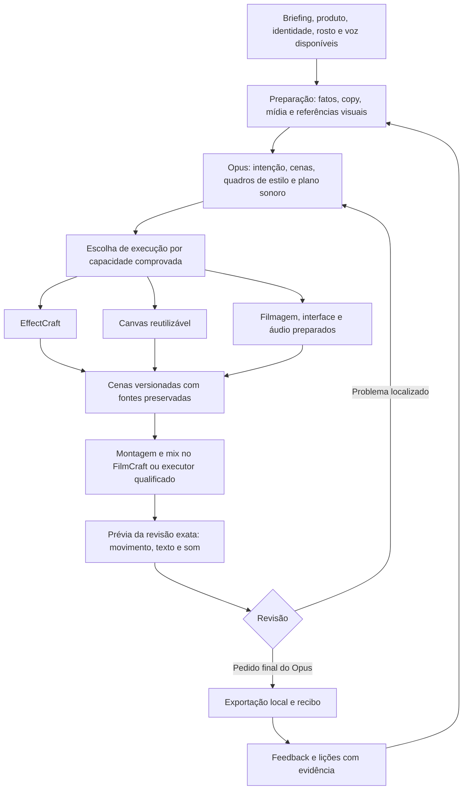

# Clicko: caminho verificável até a qualidade das referências

13/11/2026 · Plano de melhorias, ainda não implementado. Investigação e prova pontual local: **US$ 0 de API**. Não houve nova geração de anúncio nesta rodada.

## Decisão

**O fluxo híbrido é um caminho plausível para a meta, mas não basta por si só.** A recomendação é preparar materiais e direção, corrigir a observação do resultado e qualificar os executores por operação. Reaproveitar Canvas/Chromium faz parte desse trabalho. Não existe ainda prova de que integrar outro motor, aumentar agentes ou gastar mais fará a Clicko alcançar as três referências.

Há capacidades úteis já construídas: edição por código, rascunhos, retomada, inspeção, memória externa e exportação local. Existe inclusive uma ponte EffectCraft → FilmCraft. O trabalho é completar e comprovar esse fluxo, preservando a liberdade editorial do Opus e o primeiro avanço reconhecido pelo usuário.

O objetivo comercial continua sendo receber materiais de produto/serviço e apresentador e entregar um anúncio. A prioridade desta fase é qualidade audiovisual; a demonstração de um piloto não substitui essa meta. Dominar qualquer tipo de vídeo é uma direção de produto de longo prazo, não uma capacidade demonstrada pelas três referências.

## O que a investigação estabeleceu

| Achado | Evidência e limite | Consequência para a decisão |
|---|---|---|
| As fichas novas chegam como descrição, sem carregar automaticamente seus exemplos visuais. | `craft_direction.references` devolve JSON; `evidenceImage` guarda filenames; `view_image_asset` exige ativo registrado. Os hashes das três folhas atuais não aparecem no cadastro consultado. Isso não exclui outras imagens importadas anteriormente. | Ligar referência, trecho, imagem e ativo acessível ao diretor. Uma ficha no contexto não comprova que ele viu o exemplo. |
| A sessão do diretor ainda não executa o Canvas independente. | O rascunho usa um engine por sessão; o renderizador positivo é externo e específico da ÓRBITA. | Criar um adaptador reutilizável apenas depois de qualificar seu contrato de saída. Evitar reconstruir infraestrutura em cada vídeo. |
| A montagem híbrida pode aproveitar uma ponte existente. | `craft.py:1610–1663` exporta composição do EffectCraft, registra dependências e aplica `composition.link` no FilmCraft. Hoje essa rota exige origem EffectCraft. | Estender a interoperabilidade necessária; não reconstruir toda a montagem, mídia e exportação. |
| Preparação de mídia/copy e ferramentas da sessão não fecham o percurso do cliente. | Kit e dossiê existem; há itens ainda não importados. A busca pública desta sessão traz imagens. Voz, vídeo e geração têm mecanismos em outros módulos, sem uma passagem completa pelo diretor. | Coordenar as capacidades existentes e registrar necessidades não atendidas. Não confundir encontrar uma imagem com preparar uma ação de produto. |
| A revisão não comprova escuta nem movimento integral. | `review_clip` envia ao modelo imagens, medidas e metadados; um arquivo reproduzível na interface não significa que o modelo ouviu o mix. Amostragem e janelas locais existem, com cobertura limitada. | Examinar passagens em sequência e criar revisão sonora real; distinguir medição técnica, escuta e julgamento editorial. |
| O positivo independente ainda é incompleto. | MP4 de 16 s, feedback positivo do proprietário, sem áudio; exportação recuperada manualmente depois do encerramento da sessão. O clarão está no próprio código Canvas. | Preservar esse baseline. Não chamá-lo de anúncio aprovado ou prova de superioridade causal do Canvas. |
| A memória existe, mas o aprendizado geral continua por provar. | Fichas, feedback e lições versionadas existem. As três novas técnicas estão como `knowledge_only`/`not_tested`. | Demonstrar escolha, execução, contraexemplo e transferência para outro briefing antes de promover uma técnica. |

Fontes de código, linhas e escopo: [auditoria técnica](../studios/research/2026-11-13-motion-quality-investigation/10-backend-audit.md). Hipóteses concorrentes e comparação visual: [análise editorial](../studios/research/2026-11-13-motion-quality-investigation/12-causal-editorial-analysis.md).

**Prova local nova:** oito solicitações de quadro do renderizador existente, em seis tempos distintos, com repetições fora de ordem e comparação adicional em página nova. Os quadros repetidos coincidiram por hash; todas as amostras eram opacas (alfa 255). Foram 4,26 s para essas solicitações, não para um filme completo. O salto de brilho perto de 8 s permaneceu. O pacote de fontes/fontes tipográficas foi arquivado e reproduzido de uma extração separada no mesmo ambiente, com os mesmos hashes dos quadros. Isso sustenta reutilização pontual, mas não prova transparência, suavidade integral ou qualidade artística. [Recibo e reprodução](../studios/research/2026-11-13-motion-quality-investigation/probes/README.md).

Os ensaios anteriores mudaram ferramentas, contexto e materiais simultaneamente. Por isso, não isolam quanto da diferença veio do editor, da direção ou da mídia.

## Meta editorial preservada

| Referência aceita | O que buscamos aprender e aplicar | O que não foi comprovado |
|---|---|---|
| [@paulo.ia — Olise/bola dourada](https://www.instagram.com/reel/Dd5Md7NMj7P/) | Motivo reconhecível entre planos; escala, profundidade, textura e continuidade visual. | Ferramentas originais, qualidade sonora e trajetória fina de todos os movimentos. |
| [@creators / @martsromero — matcha](https://www.instagram.com/reel/DdW0UoSxXsX/) | Produto participando de gestos e contextos reais; variedade de planos a serviço de uma ação. | Uma receita universal de transições ou uma jornada contínua de uma única pessoa. |
| [@moonsol.design — colagem](https://www.instagram.com/moonsol.design/reel/Dcys2J3MfYK/) | Preparação por componentes, correspondência entre silhueta e objeto, hierarquia de retrato e texto. | Que a duração do tutorial seja a cadência ideal de um anúncio ou que sua instrução de 0,5 s valha para qualquer peça. |

São alvos de dimensões diferentes. Não basta copiar a densidade de cortes. O plano precisa tornar perceptíveis a mensagem, a transformação e a identidade do produto. O processo da Ordinary Folk reforça a utilidade de mensagem, design/storyboard e áudio pensado desde o início; é um relato de prática, não uma garantia científica de resultado. [Processo do estúdio](https://www.ordinaryfolk.co/process).

O processo atribuído ao Matheus fica como registro histórico: materiais organizados, ferramentas prontas, referências persistentes, planejamento, prévia, correção e entrega. Sua página não pôde ser reaberta nesta rodada. Não afirmamos ter observado seu pipeline interno nem que sua ferramenta seja obrigatória. [Auditoria de procedência](../studios/research/2026-11-13-motion-quality-investigation/13-reference-and-provenance.md).

## Arquitetura proposta

Esse é um desenho proposto, não uma integração já entregue. Uma peça pode usar um único executor quando isso for suficiente. O Opus escolhe duração, linguagem, cenas, cortes, camadas e efeitos; o contrato mantém materiais e resultados consistentes. Não impõe template, número de cenas ou frequência de cortes.

**Contrato de referência:** URL/autoria, cobertura observada, tempos, imagens ou trechos registrados, assetId/hash, áudio avaliado ou pendente, função editorial, contraexemplo e teste reproduzível. Material de análise e material autorizado/preparado para produção têm papéis separados.

**Contrato de cena:** sceneId, intenção e estados, fonte editável, revisão, executor/build, ativos/fontes e hashes, dimensões, FPS racional, duração em quadros, cor/alfa, clipe de saída, stems/eventos sonoros e evidência de revisão. Fonte nativa e código livre continuam possíveis. O clipe renderizado não substitui o projeto-fonte.

**Contrato de entrega:** projeto e revisão fixados; rascunhos retomáveis; pedido `finish_project` rastreável; exportação/mix locais independentes da conexão do modelo; MP4 final ligado ao recibo. Recuperação humana fica identificada.

Preservar isolamento de credenciais, integridade de arquivos, revisão correta e controle de gasto. Essas proteções não limitam a estética. Separar orçamento de inferência, tempo de trabalho, duração do anúncio e delegação, hoje parcialmente acoplados.

## Etapas práticas e condições para avançar

| Etapa / responsável funcional | Trabalho concreto | Prova para concluir |
|---|---|---|
| **P0.1 — Pesquisa e direção editorial** | Preservar baseline por hash; registrar as evidências visuais das três referências como ativos consultáveis. Completar a observação dos trechos e do som necessários à comparação. Definir rubrica por dimensão e fatos/copy da ÓRBITA. | Uma referência selecionada chega ao contexto como pixels identificados e ordenados, não apenas filename. Critérios e cobertura ficam registrados antes da comparação. Uma dimensão sem cobertura temporal/sonora suficiente fica explicitamente não comparável. |
| **P0.2 — Engenharia de execução** | Qualificar cenas necessárias: texto/curvas; recorte/oclusão; luz/sombra quando requeridas; passagem e sincronismo. Rodar a mesma cena no Craft direto e pela Clicko; depois comparar a operação equivalente em Canvas. | Localização reproduzível de falha do motor ou integração, ou aprovação da operação nas condições medidas. Materiais, fontes, especificação visual e condições iguais; tolerâncias definidas antes do teste. |
| **P0.3 — Revisão audiovisual** | Calibrar detecção com pares corretos/defeituosos: colisão real, pico luminoso, texto ilegível, som ausente ou deslocado. Revisar movimento por janelas e o mix efetivamente ouvido. | Acertos e falsos positivos registrados por tipo e tempo, inclusive controles corretos. Sem aprovação sonora baseada só em RMS/transcrição e sem aprovação temporal baseada só em stills. |
| **P1.1 — Engenharia de integração, condicional a P0.2** | Se a prova justificar Canvas, tornar o runtime reutilizável e conectar cenas completas opacas à montagem com fontes/revisões preservadas, aproveitando cadastro, jobs e ponte existentes. Qualificar alfa em prova separada. Se Craft bastar, conservar a opção A. | Alterar uma cena, renderizar e recompor sem perder fontes nem outras cenas. Prévia/exportação correspondem à revisão atual. Oclusão/transparência só anunciadas após teste real de bordas e composição. |
| **P1.2 — Produto, copy e preparação de mídia** | Coordenar kit/dossiê com importação, preparação e busca de materiais; ligar voz/mídia existentes quando adequadas. Traduzir copy em ações e quadros de estilo; preparar som junto do animatic. | Cada ação do plano tem material executável ou lacuna explícita. Não inventar fatos/oferta. Produto/identidade persistem nas mudanças. Prévia de ritmo permite conferir a relação entre imagem, texto e som. |
| **P1.3 — Orquestração e autonomia** | Disponibilizar recursos e tempo restantes, plano persistente e revisão independente. Retomar sem reescrever infraestrutura. Especialistas são opcionais e recebem entregas delimitadas. | Com respostas simuladas e motores reais: interrupção, retomada, conflito de revisão e exportação completa sem intervenção. Depois comprovar decisão/exportação do Opus em sessão real; a simulação não prova isso. |
| **P2.1 — Experimento pago controlado** | Somente após as provas anteriores, executar direção com materiais/runtime prontos. Comparar uma variável editorial ou de execução por vez, usando a ÓRBITA e o baseline preservado. | Vídeo completo, revisão ligada ao arquivo, recibo e comparação por dimensão, custo/tempo/retrabalho. Registrar também falhas e intervenções. |
| **P2.2 — Aprendizado e ampliação** | Aplicar a técnica a briefing novo e testar caso em que não convém. Depois ampliar famílias: filmagem real, demonstração de interface, colagem/motion, híbridos. | Escolha e execução pertinentes sem fornecer a resposta do caso; recusa correta no contraexemplo. Uma lição aprovada não autoriza a conclusão de domínio de todos os gêneros. |

P0.1–P0.3, preparação de materiais/copy de P1.2 e o desenho do adaptador podem avançar em paralelo, com saídas compartilhadas. A implementação híbrida depende de P0.2 justificar sua utilidade e do contrato qualificado. Um novo ensaio pago depende da preparação e da cadeia de entrega completas. Não há prazo confiável em dias antes de dimensionar essas mudanças; o plano controla avanço por evidência.

## Provas locais específicas

1. **Texto e movimento:** fontes reais, acentos, quebra e bounds; curvas de entrada/saída e leitura em tela de 300 px. Verificar janelas em velocidade normal e quadro a quadro, separando continuidade geométrica de preferência estética.
2. **Recorte e profundidade:** pessoa/objeto com matte fornecido e correspondência real de silhueta; texto atrás da pessoa e contato com o plano. Só depois testar a produção automática do matte, para não misturar segmentação e composição.
3. **Luz e transição:** reproduzir o pico conhecido em cópia, medir tempo/área e testar sua correção; preservar um controle luminoso deliberado para revelar falso positivo. Conferir continuidade de sombra quando o plano pede materialidade.
4. **Intercâmbio:** clipe opaco primeiro; camada transparente em caso separado, com fundos contrastantes para revelar halos e alfa errado. Cor, tempo-base e sincronismo conferidos após a decodificação final.
5. **Som e entrega:** cues, mix e fades com alinhamento mensurável, além de escuta de inteligibilidade e intenção. Simular corte de conexão e resposta final; exportação deve preservar duração, streams e revisão. Não aceitar arquivo silencioso quando a direção exige som.

São provas propostas. As execuções novas desta investigação limitaram-se à amostragem pontual Canvas e à reprodução do seu pacote arquivado, descritas nos recibos. Os testes históricos de recuperação/enxame continuam evidência histórica, não novos testes estéticos.

## Indicadores anotados e critérios de análise

| Indicador | Registro e critério | O que não permite concluir sozinho |
|---|---|---|
| **Sentido/compreensão** | Descrição espontânea: o que está sendo anunciado, qual promessa e qual ação se espera. Gabarito factual definido antes; comparar mensagens corretas, omissões e invenções. | Preferência do proprietário não é compreensão de uma população. |
| **Contribuição de cada trecho** | Intenção e estado antes/depois; apontar a evidência de algo revelado, transformado ou enfatizado. Trechos sem função entram em revisão. | Quantidade de cortes não mede ritmo ou valor. |
| **Movimento e continuidade** | Intervalo observado, trajetória, easing, oclusão, contato e continuidade relevante; defeito localizado com evidência. | Um movimento fisicamente plausível pode ser editorialmente inadequado; estilo gráfico não exige realismo universal. |
| **Texto e identidade** | Copy exata, categoria/convite legíveis no tamanho de uso, ausência de colisão, identidade reconhecível; tempo de leitura examinado na reprodução. | Bounding box correta não garante leitura confortável ou hierarquia. |
| **Som e sincronismo** | Streams presentes, eventos/fades alinhados, escuta registrada; voz inteligível e som com função, sem mascaramento indesejado. Silêncio intencional identificado. | RMS/onsets/transcrição da fonte não comprovam qualidade do mix final. |
| **Acabamento por referência** | Comparação pareada nas dimensões pertinentes: materialidade/continuidade, produto em ação ou composição/transformação. Justificativa por trecho. | Não existe uma nota universal de “parecido com Instagram”. |
| **Qualidade da revisão** | Detecção e falsos positivos por defeito nos controles, mais cobertura temporal e sonora. Reportar contagens e denominadores. | Detector técnico não é crítico artístico validado. |
| **Autonomia e retrabalho** | Pedido de exportação do Opus, intervenções humanas, retomadas, revisões locais e entregas incompletas. | Número de chamadas/ferramentas não é qualidade. |
| **Eficiência de investimento** | Uso e custo por modelo/etapa, tempo total e local, custo por vídeo aprovado com o critério explícito; cobranças incertas separadas de reservas. | Gastar todo o teto não melhora a peça. Custo por aprovado não é calculável sem aprovações. |
| **Transferência** | Ficha recuperada, evidência vista, decisão e execução em caso novo; resultado também no contraexemplo. | Guardar documentos ou passar testes de consulta não demonstra aprendizado editorial. |

Não somar essas dimensões para esconder uma falha essencial, como oferta incorreta, texto ilegível ou áudio obrigatório ausente. A calibração inicial usa revisão humana explícita, seguida de controles que o sistema consegue verificar. Uma avaliação cega com espectadores precisa de protocolo, tamanho de amostra e análise definidos antes da coleta; nesta rodada não há espectadores, ganho percentual, intervalo de confiança ou qualidade comercial comprovada.

A separação entre integridade, aderência e craft é consistente com a orientação de [avaliações de agentes da Anthropic](https://www.anthropic.com/research/demystifying-evals-for-ai-agents). O [Timeline-Bench](https://arxiv.org/abs/2609.35143), consultado no resumo e ainda preprint, também distingue entrega técnica de qualidade de edição. Seus resultados não são uma previsão da Clicko.

## Escolha de ferramentas e capital

**A — manter Craft:** preferível se as operações essenciais passarem. Corrigir materiais, contexto e revisão continua necessário. Menor mudança estrutural, com risco de deixar uma operação de acabamento sem solução.

**B — reutilização híbrida, recomendação condicional:** manter Craft e acrescentar Canvas onde a prova mostrar utilidade. Começar por cenas opacas; preservar fontes e estender ligações existentes. Risco adicional de cor/alfa/tempo e manutenção de dois caminhos. Só ampliar quando o intercâmbio e o ganho forem demonstrados.

**C — ferramenta especializada isolada:** investigar apenas se uma operação essencial não passar nos caminhos disponíveis. Comparação pequena com mesmos materiais e alvo, antes de licenças, infraestrutura ou substituição. Não há justificativa atual para reintroduzir HyperFrames/MCP ou trocar tudo pelo nome de uma ferramenta. O upstream EffectCraft não é o After Effects da Adobe; paridade anunciada pelo projeto não comprova o build instalado nem o acabamento da nossa peça.

**Próximo investimento recomendado:** primeiro implementação e provas locais, com US$ 0 de inferência. Para a etapa paga futura, proposta de uma tranche de até **US$ 5**, liberada apenas quando esses critérios passarem, com teto por trabalho definido antes da execução e sobra preservada. O valor é limite de teste, não meta de consumo ou estimativa garantida de custo por anúncio. Esta proposta não altera configurações nem autoriza uma geração agora. Crédito Anthropic também não custeia automaticamente provedores externos de mídia.

O saldo exato Anthropic continua pendente da conferência do usuário; a estimativa financeira anterior não se tornou saldo confirmado. Reservas, uso verificável e cobranças incertas devem continuar separados. Mais agentes só entram se uma comparação demonstrar ganho útil frente ao custo/latência; um papel de revisão pode começar como etapa independente, sem equipe fixa de chamadas pagas.

**Continuidade com o plano do conselho:** o registro anterior distribuiu os US$ 200 em baseline US$ 10, edição/qualidade US$ 70, motion US$ 20, longos US$ 0, piloto US$ 50 e reserva US$ 50. São envelopes históricos de planejamento, não saldos atuais de cada categoria; faltam conciliar e classificar todos os recibos posteriores para afirmá-los. O direcionamento atual mantém piloto fora do foco. A tranche proposta pertence à melhoria de qualidade/motion e não redistribui automaticamente piloto ou reserva. Preservar a regra anterior de duas tentativas pagas sem avanço exigirem diagnóstico local; falhas cobradas entram no custo. [Plano de capital e indicadores anteriores](2026-11-10-geracao-aprofundada-e-capital.md).

## Critério de decisão ao final

- **Avançar com o híbrido:** operações e intercâmbio passam, a peça completa melhora dimensões relevantes sem regressão essencial e o custo/tempo ficam documentados.
- **Manter Craft como executor principal:** as mesmas operações passam e o ganho veio de materiais, direção ou revisão. Não adicionar arquitetura sem necessidade.
- **Rever a execução:** uma operação necessária falha de forma reproduzível ou o intercâmbio degrada o acabamento. Investigar essa operação, sem descartar o sistema inteiro.
- **Manter a conclusão aberta:** diferença apenas subjetiva sem controle, vídeo incompleto, cobertura de áudio/movimento insuficiente ou falta de avaliadores. Não promover domínio geral.

O próximo marco útil é uma cena curta com acabamento-alvo e fonte editável, feita com mídia preparada, observação suficiente e execução reproduzível. Depois, anúncio completo com som e exportação autônoma; por último, transferência. Esse encadeamento dá uma meta clara a cada gasto e evita recomeçar o filme inteiro a cada tentativa.

## Dossiê e limites

[Índice da investigação](../studios/research/2026-11-13-motion-quality-investigation/README.md): pergunta, método, desenho, auditoria de backend, fontes primárias, hipóteses editoriais, procedência, alternativas, confiabilidade e vieses. As fontes externas apoiam mecanismos e desenho dos testes; nenhuma mede o efeito causal do híbrido na Clicko. A inspeção visual das referências é amostrada e seu som segue sem auditoria nesta rodada.
