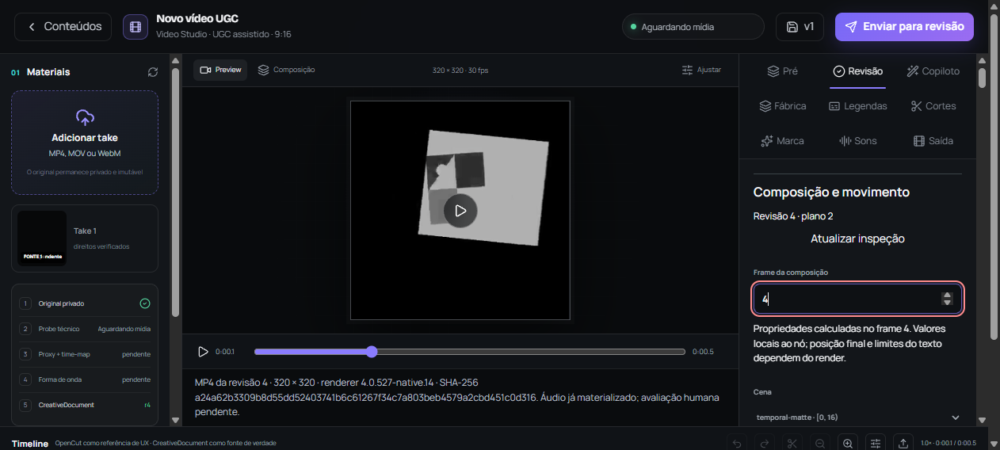

# Prévia canônica e exposição herdada — 04/10/2026

O canvas central do Video Studio agora exibe o MP4 da revisão atual, com as dimensões da página, proporção preservada e relógio da composição. Ele usa o mesmo blob privado do painel de inspeção e da saída. No modo renderizado, não acrescenta os overlays aproximados de legendas/marca nem prepara novamente o áudio da prévia de materiais. Revisão/documento/versão/checksum e QC técnico controlam a associação. Uma edição ou draft local retira a prévia anterior e pede um novo render.

Projetos que ainda utilizam a prévia de material conservam esse fluxo, identificado como aproximação. Nenhum renderer, contrato canônico, schema ou serviço backend foi alterado nesta rodada. O original continua em `C:\Users\edugu\Downloads\res`.

## Prova pela interface e pelo arquivo

- Na revisão 3 da fixture existente, o MP4 foi carregado no canvas em 320 × 320, proporção 1:1 e `object-fit: contain`. Os frames 0, 4 e 15 foram observados. Nos frames 4 e 15, canvas e inspeção apontaram para o mesmo blob e os mesmos tempos de 4/30 e 15/30 s. Não havia safe area ou overlays de legenda/marca acrescentados ao vídeo.
- Um novo plano tipado foi aplicado pela API real no workspace de laboratório, com `expectedDocumentRevision=3`, conservando o keyframe X=12 e a imagem original. Ele move a exposição temporal da camada filha para seu grupo `rig` e cria a revisão 4. Esta mudança de plano não foi um comando da interface e não é apresentada como tal.
- Ao atualizar a revisão 4, o canvas retirou o MP4 antigo e mostrou a pendência de render. A inspeção do target `hero` mostrou “Exposição herdada do rig: rig” e a fonte externa da máscara com opacidade 0,75 no frame 4.
- O botão visível da interface enviou o render da revisão 4. O worker existente executou o job `0f1e8c78-ae19-48d2-abc6-a3577d1d0b38`; não houve execução duplicada pelo script de coleta. O MP4 teve QC aprovado, renderer `4.0.527-native.14`, SHA `a24a62b3309b8d55dd52403741b6c61267f34c7a803beb4579a2cbd451c0d316` e snapshot da revisão/versão corretas.
- A revisão 4 foi observada carregada nos frames 0, 4 e 15. A inspeção e o canvas novamente usaram o mesmo blob/relógio. Snapshot, composição inspecionada, checksum do vídeo e fonte original foram preservados nos recibos.
- Foram comparados 18 pixels RGB lidos por canvas diretamente dos players carregados: três posições × três frames × duas revisões. A referência foi a decodificação independente por FFmpeg dos MP4s retidos. O maior desvio foi 1 por canal; o limite previamente declarado desse check é 4. Este check verifica ligação/tempo/pixels do arquivo exibido, não um oráculo geométrico ou nota estética.
- O botão central iniciou a reprodução com o player de inspeção pausado. Um evento nativo `play()` no player de inspeção pausou o central. Acionar novamente o botão central pausou o de inspeção. A observação mede arbitragem dos players numa fixture sintética silenciosa; não qualifica escuta ou sincronização de áudio novo.

## Checks e fontes preservadas

`npm run lint` (`tsc --noEmit`), Ruff nos dois scripts Python e `git diff --check` nos três arquivos de interface passaram. O [recibo](temporal-matte-composition-preview/verification.json) verifica 62 fontes atuais e conserva hashes de todas as evidências da pasta. A fonte histórica do diagnóstico e os arquivos do kernel native.14 não mudaram. Fontes anteriores dos dois componentes e do CSS foram preservadas antes da edição; sete cópias atuais adicionais também foram retidas.

Os scripts novos preparam apenas o plano tipado no workspace isolado, coletam o job que a interface submeteu, registram observações DOM/pixels e conferem os arquivos preservados. Eles não importam o banco de testes nem simulam respostas. Credenciais e estado do navegador continuam em `tmp` ignorado pelo Git. Os recibos da rodada anterior permanecem intactos; sua exigência de hashes antigos pertence àquela revisão histórica, não ao código alterado agora.

A automação sofreu falhas transitórias de conexão e recarregamentos HMR; os handles foram consultados até terminar e o estado foi recuperado. Nenhum pedido de render foi repetido por causa de timeout. Usamos os servidores existentes em 3000 e 8000, sem encerrar processos compartilhados nem tentar novamente o lançamento recusado em 3319.

## Alcance e trabalho restante

A observação desta rodada abrange uma fixture quadrada 320 × 320 de 16 frames a 30 fps, em draft/CRF 28. Outras proporções, renders mais longos e cortes com source ranges precisam de observação própria da nova prévia. A seleção de frame carregou o vídeo; isto não demonstra reprodução interativa de 1080p, p95 ou custo comercial. Os arquivos grandes dos estudos anteriores não foram requalificados apenas por esta mudança de UI.

A avaliação humana dos três estudos A/B/controle nos quatro eixos, preferência cega e três briefs novos de autonomia permanece pendente. O QC técnico não preenche essas notas. A limpeza recursiva dos clones/bundles havia sido recusada pela revisão automática (`blocked by policy`); esta rodada não refez nem contornou essa ação.
