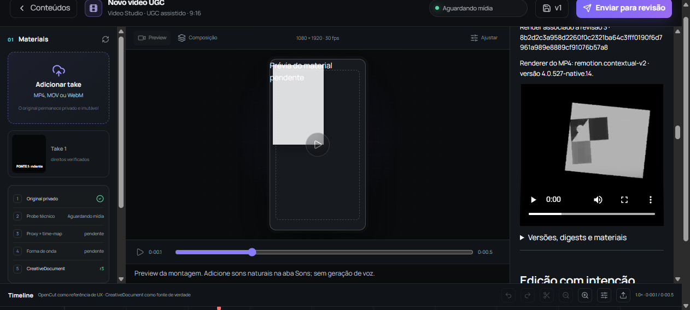

# Matte temporal: inspeção e comando pela interface — 04/10/2026

No original `C:\Users\edugu\Downloads\res`, o painel de revisão agora mostra a fonte e o parent da máscara, modo alpha/luminância, inversão, ajuste da imagem, intervalo, opacidade calculada no frame e checksum do asset. Também informa a versão do renderer quando há MP4 associado à revisão. A busca de exposição contempla ancestrais; a fixture de navegador desta rodada qualifica somente exposição na camada filha.

O teste usa o frontend existente em `http://127.0.0.1:3000`, a API real em `http://127.0.0.1:8000` e um workspace próprio. Não houve mock, nova engine, nova chamada paga ou importação do banco de pytest. Credenciais e estado do navegador ficam em `tmp` ignorado pelo Git. O servidor 3317 servia módulo antigo; o lançamento de outro servidor em 3319 foi recusado pela revisão automática. Nenhum processo compartilhado foi encerrado.

## Resultado verificável

- A máscara original 80 × 96 foi importada pela API, com checksum `ee10f031a17421859e3af5f725273644b8534709cb23173c6e1bf0ac8787e2c2`. A combinação é alpha invertido, fonte externa com parent móvel e exposição de oito amostras na camada filha. Composição: 320 × 320, 16 frames, 30 fps.
- A interface observou a fonte com opacidade 0,75 no frame 4; seu parent tem opacidade base 0,2. No target, a máscara mostra 0,8625 no frame 7 e hold de 0,9 no frame 10. Estes registros inspecionam o contrato; não constituem experimento de alteração da opacidade do parent.
- O botão visível da interface submeteu o job da revisão 2. O pipeline produziu um MP4 com QC aprovado, `remotion.contextual-v2` / `4.0.527-native.14`, SHA `956c9bf0f8d09e7270dd0e4192c02c6ac32f2e31b72a70c3965e6fa7cec04bf8`.
- Pela interface, o primeiro keyframe X da receita existente `hero-move` foi substituído de 0 por 12. O ledger registra `set_recipe_keyframe`, revisão 2 → 3 e digests novos de documento/grafo/composição. Todas as outras receitas permanecem iguais.
- Após recuperar a interface de um recarregamento HMR, a revisão 3 apareceu com X = 12 e sem MP4 associado. A ausência foi observada depois da recuperação, não continuamente durante o comando.
- Um segundo pedido da interface gerou outro MP4 com QC aprovado, mesmo renderer, revisão 3, SHA `8b2d2c3a958d2260f0c2321ba64c3fff0190f6d7961a989e8889cf91076b57a8`. Snapshot, versão, revisão, asset original e checksum foram conferidos em ambos os recibos.
- A captura da revisão 2 registra metadados do vídeo e seek solicitado em 4/30 s (`readyState=1`). A revisão 3 tem frame carregado (`readyState=4`), seek em 4/30 s e screenshot retido. A captura antiga não foi substituída por uma reconstrução posterior.

## Consequência no arquivo renderizado

O deslocamento esperado deriva da geometria authored, sem ajustar um oráculo aos pixels observados. No frame 0, a borda esquerda passa de x=45 para x=57. O bloco 2 × 2 em (50,60) deixa a camada; a máscara invertida tem cobertura branca ali, fora da fonte externa. A média RGB do bloco cai de 179 para 0. O bloco interno em (64,60) permanece claro: 178 → 179,5.

Ambos os vídeos foram decodificados por FFmpeg: 16 frames de 320 × 320. Os pedidos reais da interface usam qualidade draft/CRF 28. Este check demonstra o deslocamento grande de uma camada; não aplica o limite do oráculo de rasterização high/CRF 10 a estes vídeos e não atribui nota audiovisual.

## Fontes, checks e alcance

[O recibo independente](temporal-matte-inspection-browser/roundtrip-verification.json) verifica 57 hashes atuais, os dois MP4s, snapshots e comando, as capturas DOM e os blocos geométricos. Os 46 hashes do kernel previamente admitido e 11 fontes adicionais ficaram fixados antes da rodada. O verificador tem seu próprio SHA no recibo. Capturas e inspeções antigas permanecem intactas, inclusive uma captura da revisão 3 que ainda selecionava o grupo raiz; a conferência usa a captura seguinte do target `hero`.

O compilador TypeScript precisa excluir `docs/studios/research`: essa pasta preserva cópias históricas TS/TSX e projetos experimentais independentes. Ela não pertence ao grafo ativo do app. `npm run lint` (`tsc --noEmit`) passou com as fontes atuais do app. Os dois scripts Python desta rodada passaram em Ruff. O diff dos dois componentes e do tsconfig passou em `git diff --check`; a conferência final confirmou os 57 hashes de fonte, os arquivos de evidência e o SHA do verificador.

As chamadas de render coincidiram com um worker ativo: a primeira leitura do wrapper ainda encontrou `running`, e a coleta posterior encontrou `succeeded`. Nenhum pedido foi repetido por causa do timeout de observação. A automação precisou rolar explicitamente o contêiner lateral para clicar nos botões visíveis.

O canvas central ainda exibe a prévia de material e dimensões padrão 1080 × 1920; ele não representa o renderer desta composição 320 × 320. O MP4 canônico qualificado nesta rodada aparece no painel de revisão. Essa divergência continua uma limitação de UX, e o screenshot a preserva.

Exposição herdada de rig ainda precisa de observação própria pela interface. Permanecem pendentes avaliação humana das três peças em quatro eixos, preferência cega e autonomia em novos briefs. A revisão automática recusou anteriormente a limpeza recursiva dos clones/bundles de estudo (`blocked by policy`); a remoção não foi refeita nem contornada.
