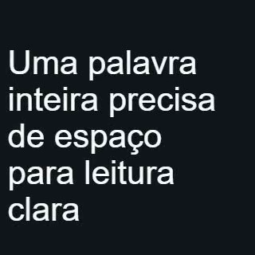

# Layout com fonte final — recibo técnico

Novas compilações de `integrated_type` medem as unidades canônicas realmente montadas depois de carregar a fonte. O espelho DOM conserva palavras/grafemas, whitespace, peso, spacing, alinhamento e line-height, removendo as transformações de entrada/pais apenas da medição local. Range fornece caixas/linhas; altura do bloco inclui linhas vazias; Canvas TextMetrics fornece baseline e métricas de ink separadas. A geometria mundial continua sendo observada no DOM do render.

O ajuste mantém o tamanho solicitado quando o layout cabe. Se necessário, busca um tamanho menor até o piso existente de legibilidade (canvas width × 16/300, mínimo 8 px); não reescreve texto ou troca fonte. Uma palavra impossível nesse piso interrompe o renderer com target/frame e sugestão de ampliar a caixa ou encurtar o conteúdo. Fonte ausente, checksum divergente e glifo inexistente continuam rejeitados.

[Compatibilidade registrada antes da alteração](TEXT_LAYOUT_COMPATIBILITY.md): política `studio.typography-layout-policy.v1`/`dom.units-fit.v1`, compilador `res.native-recipes.v3`, component library 5, provider `4.0.527-native.7`. Unidades e `recipeTypography` V2 conservam suas versões. Operações v1/v2 e o componente separado `integrated_typography` V1 continuam com a semântica anterior; recompilação é explícita. Política, binding e parâmetros entram nos digests. Não houve cópia de código dos editores estudados; o helper é original.

Limites de custo: 2.000 unidades, até 18 passos de busca (21 medições contando pedido/piso/verificação), quantização de 1/64 px e cache de 128 entradas por contexto do browser. Chave inclui digest da composição, texto, unidades, caixa, fonte, estilo e política. Não há cache persistente ou segundo modelo de projeto.

## Evidência desta versão

[text-layout-receipt.json](text-layout-receipt.json) consolida **86 casos pytest únicos aprovados**, sem falhas/skips; os XMLs se sobrepõem. A regressão de 81 casos inclui os comandos reais por API/job (shape e rig), Unicode/fonte/hold, grafo/derivadas, contratos nativos e trim/speed com fontes de 24/60 fps. A fixture anterior de máscara/stroke/parenting/blur também passou. Os 766 vetores oficiais de Unicode são executados por um desses casos, não somados como 766 testes adicionais.

[text-layout-dom-study.json](text-layout-dom-study.json) registra **13 casos no Chromium real**: wrap, grupo rotacionado/escalado sem contaminar métricas locais, acentos decompostos, linhas vazias, shrink, fontes com pesos 400/700, spacing, alinhamento e quatro rejeições. Usa Arial/Arial Bold instaladas localmente; hashes das fontes e código executado estão registrados. Um teste inicial que esperava largura diferente para negrito sintetizado foi corrigido para carregar o arquivo do peso real, sem presumir alteração de advance width.

Prova principal com upload da fonte → plano/API → apply → inspeção da revisão → job → MP4 → FFmpeg/QC/pixels:

| Fixture | Resultado medido | Vídeo e recibo |
|---|---|---|
| Acentos decompostos `AÇÃO` | 4 unidades; conclusão no frame 19; hold 19–29; 42 px | [MP4](text-layout-render/unicode/typography.mp4), [evidência](text-layout-render/unicode/evidence.json) |
| Parágrafo com palavras inteiras | 9 unidades; 5 linhas; 42 px preservados; altura 230,9375 px; conclusão no frame 10 | [MP4](text-layout-render/wrapped_words/typography.mp4), [evidência](text-layout-render/wrapped_words/evidence.json) |

Ambos: 320 × 320, 30 fps, 60 frames/2 segundos, segunda cena com controle sequencial de stagger zero, QC técnico passed. A fixture é silenciosa; avisos de loudness/silêncio não qualificam sincronização de fala. Durações observadas de render: 11.016 ms e 9.063 ms; são amostras locais, sem p95 ou promessa de realtime.

Pixels completos decodificados: diferença média por canal começo/fim do hold 0,009079 (acentos) e 0,030967 (parágrafo). Frente ao controle: 0,269590 e 1,392155, dentro das tolerâncias H.264 declaradas nos testes. Checksum do parágrafo: `97ef10bcf5a224a1caee5dec02ba7cf843cd76d214cda6318f113191251ce00a`.

Provas suplementares passam diretamente pelo documento/grafo/projeção/provider reais, sem afirmar API/job:

- [style-parent.mp4](text-layout-negative/style-parent.mp4) e [recibo](text-layout-negative/style-parent.json): no frame 14, fontSize 42→32, peso 400→700, spacing 0→2, line-height 1,2→1,4 e pai com rotação 15°/scale 1,2. AABB mundial confere com a fórmula independente (275,3038 px), e métricas locais permanecem estáveis no repouso. Diferença de pixels 14→29: 0,000697 por canal. O peso 700 dessa fixture usa a síntese do font engine sobre o asset declarado; o estudo DOM separado carrega o arquivo Bold real.
- [negative.json](text-layout-negative/negative.json): palavra impossível com a fonte final é rejeitada no frame 0 com target/correção. Nenhum arquivo de saída é publicado. Negativos de asset/checksum/glifo também passaram na regressão.

Ruff, TypeScript do worker, `node --check` e verificação do diff passaram. Os testes de trim/speed 24/60 fps passaram nesta regressão; as falhas anteriores continuam documentadas como histórico, sem apagá-las ou generalizar essa fixture para toda mídia.

## Limites preservados

O ajuste decide por wrapping/altura de bloco DOM local; ink é diagnóstico do font engine, não prova de clipping/cobertura em pixels. Não qualifica kerning entre spans, shaping Indic/emoji, legibilidade depois de scale do pai, títulos extremos no celular ou adequação estética. Fontes sem asset são explicitamente marcadas `unfixed_platform_font`. Nenhuma nota humana foi preenchida; qualificação visual, matte arbitrário e autonomia em briefs novos permanecem pendentes.

A revisão automática rejeitou a exclusão das cópias/bundles com `blocked by policy`; nenhuma remoção ou recuperação de espaço foi confirmada. Além dos clones (~3,7 MiB lógicos), os dois bundles desta medição ocupam 59.308.030 bytes lógicos (~56,6 MiB) em `tmp/text-layout-dom-study-*`. Não foram feitas tentativas de contornar o bloqueio. Fontes usadas no estudo não estão nos artefatos documentais ou fixtures versionadas; os bundles temporários ainda contêm suas cópias e aguardam limpeza.
