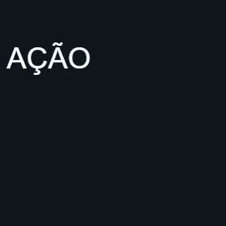

# Unidades de tipografia e hold — recibo da implementação

Na receita `integrated_type` compilada agora, `character` anima grafemas inteiros: `AÇÃO` mantém quatro unidades (`A`, `Ç`, `Ã`, `O`), e o emoji de família permanece uma unidade na segmentação canônica. O texto original não é normalizado. Whitespace fica preservado e não consome stagger. Compilador e renderer usam a mesma lista materializada, com índices, política, checksum e frame de conclusão; não existe uma segunda decisão de segmentação no browser.

A compilação sobe para `res.native-recipes.v2`, component library 4 e provider `4.0.527-native.6`. Leitores conservam operações v1 com o comportamento histórico; planos antigos seguem o fluxo de recompilação quando a versão de execução diverge. O componente separado `integrated_typography` V1 conserva seu comportamento legado e precisa de um incremento próprio. [Compatibilidade](TYPOGRAPHY_COMPATIBILITY.md) foi registrada antes das alterações.

O mecanismo usa a dependência explícita `regex==2026.1.15`, já instalada no ambiente. A política fixa Unicode 17; mudança de versão produz erro. Os 766 vetores oficiais de `GraphemeBreakTest` passaram. O arquivo de dados original e a Unicode License V3 ficam nas fixtures, com proveniência e hashes. Não copiamos código dos editores estudados. Licença do pacote: Apache-2.0 AND CNRI-Python.

Validação final, em [typography-receipt.json](typography-receipt.json): **91 casos únicos aprovados**, zero falhas/skips. As contagens dos XMLs se sobrepõem e não são somadas diretamente:

- `typography-contract-tests.xml`: 24 testes de Unicode, conteúdo/índices/timing inválidos, whitespace/hold exato, leitura v1, targets e fonte ausente/checksum divergente/glifo inexistente. Negativos de fonte passam pelo provider real e interrompem antes de gerar arquivo.
- `typography-regression-tests.xml`: 84 testes de tipografia, grafo/derivadas, editorial V2, receitas e comandos; três casos de pixels/MP4 foram selecionados em rodadas próprias.
- `typography-real-regression-tests.xml`: três exportações reais aprovadas — tipografia por API/job e as duas fixtures anteriores de comandos e parenting.
- `typography-native-pixel-regression-tests.xml`: fixture existente de máscara retangular, stroke, parenting e exposição temporal passou com o runtime atual.
- `typography-runtime-study.json`: 12 combinações de texto/unidade e seis negativos executam a função JSX extraída do worker atual. As 31 verificações numéricas anteriores, com 6.010 amostras de curvas, continuam aprovadas.
- Ruff, compilação TypeScript do worker e verificação do diff passaram.

## Prova real da receita

[typography-render/typography.mp4](typography-render/typography.mp4): 320 × 320, 30 fps, 60 frames/2 segundos. Primeiro trecho: entrada em quatro unidades; segundo: controle sequencial com a mesma fonte, texto e unidades, stagger zero. O controle fica em outra cena para respeitar o diagnóstico existente de texto duplicado concorrente. Nenhum gate foi desligado para aceitar a fixture.

Fonte Arial instalada localmente, enviada pela API existente de recursos e vinculada por checksum. O teste não inclui seu binário no repositório/evidências. A versão canônica contém fontes/assets e digests; job usa Remotion e finalização FFmpeg reais. A fonte passa pela verificação existente de cmap/checksum; falta de asset, divergência e glifo ausente interrompem o provider, sem fallback.

Checksum do MP4: `814285f2c3495dc8d69850ca0ea2345b592d9c16f578ca25946ab6529f139aef`. QC técnico: passed, com avisos esperados de silêncio/loudness na fixture sem fala ou música. Não demonstra sincronização de fala.

Geometria dos spans confirma os textos inteiros, quatro índices, fonte vinculada, opacidades e conclusão no frame 19. Os frames 19 a 29 fornecem 11 frames de hold completo. Comparação de todos os pixels decodificados: erro médio absoluto por canal 0,009079 entre começo/fim do hold; 0,269590 frente ao controle, ambos abaixo das tolerâncias declaradas para H.264. O primeiro frame tem zero canais claros; o frame acomodado tem 3.670. [evidence.json](typography-render/evidence.json) conserva snapshot, revisões, versões, hashes, QC e amostras de geometria/pixels.

## Limites e próximos trabalhos

Caixas DOM de spans são diagnóstico de layout/transformação; não são ink bounds nem cobertura de máscara. A prova de fonte real cobre os acentos latinos decompostos dessa fixture. Emoji, shaping Indic, wraps extremos, peso/spacing animados e títulos longos ainda exigem provas reais e medição final própria. Segmentação correta não garante kerning entre spans, legibilidade em celular ou qualidade editorial.

Nenhuma nota humana foi preenchida e não há aprovação comercial/autônoma. Permanecem matte arbitrário, falha anterior de trim/speed de vídeo, qualificação visual dirigida e três briefs de autonomia. A limpeza dos clones temporários continua aberta porque a revisão automática rejeitou a remoção com `blocked by policy`.
